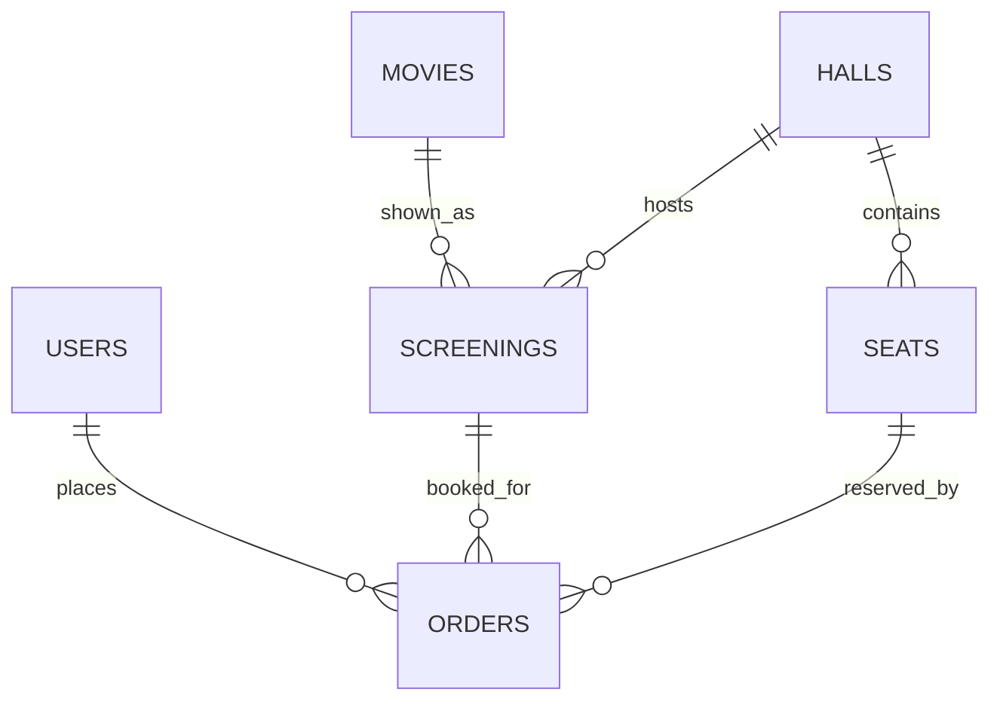

# Campus Cinema · 校园影院管理系统

11 月 19 日初步思路汇报 Demo。Python 标准库 + SQLite + 原生 HTML/CSS/JavaScript，无第三方依赖，无需联网。所有电影、用户和性能数据集均为合成数据。

## 运行

安装 Python 3.10 或更新版本。在 macOS 终端进入本目录后运行 `python3 app.py`。Windows 可以双击 `start.bat`，也可以在本目录运行 `python app.py`。

| 入口 | 地址 |
|---|---|
| 学生购票 | http://127.0.0.1:8766/ |
| 影院管理 | http://127.0.0.1:8766/admin |

两个入口共用同一个本地服务和数据库。请在浏览器打开地址。停止服务时按 Ctrl+C。如需换端口，在启动命令后加 `--port 8767`。

### 管理员账号

默认账号为 `admin`。未配置密码时，服务每次启动都会生成一个临时密码，并在终端打印。直接访问 `/admin` 并使用该密码登录即可。

也可以在同一个终端设置 `CINEMA_ADMIN_USER` 和 `CINEMA_ADMIN_PASSWORD` 后启动。只设置密码时继续使用默认账号。把示例密码替换为自己的演示密码。

macOS

```sh
export CINEMA_ADMIN_USER='admin'
export CINEMA_ADMIN_PASSWORD='your-demo-password'
python3 app.py
```

Windows PowerShell

```powershell
$env:CINEMA_ADMIN_USER = 'admin'
$env:CINEMA_ADMIN_PASSWORD = 'your-demo-password'
python app.py
```

管理员会话最长 8 小时。点击退出或重启服务会使相应会话失效。服务只监听 `127.0.0.1`。

首次运行会自动创建 `cinema.db`，之后重启保留数据。默认包含 50 名模拟用户、3 部虚构电影、1 个影厅、60 个座位、3 个场次。数据库金额用整数“分”存储。

## 功能

- 选片、场次查询、座位查询、单座购票。
- 当前用户订单查询、模拟支付、取消待支付订单并释放座位。待支付订单锁座 15 分钟，到期后自动取消并释放座位，保留订单记录。
- 电影新增/查询/修改/删除；已被场次引用的电影禁止删除。
- 影厅重命名；新增和修改场次；已有订单的场次不可修改。
- 全部订单查询与待支付订单状态维护。
- 6 实体 ER 图、字段及 SQL 示例。
- 性能实验：1 千 / 1 万 / 10 万订单，辅助索引有无，1 / 2 / 3 表查询，共 18 组。
- INSERT / UPDATE / DELETE 对照，以及 1 / 20 / 50 人抢同一座位。

## 实验复现

登录管理端后进入“性能实验室”，点击“重新运行真实实验”；或在目录内运行：

```powershell
python experiments.py
python test_demo.py
```

实验使用独立临时数据库，不改动影院业务数据。`results.json` 保存环境、时间、SQL、执行计划和原始采样；`性能对比.csv` 保存查询对照表，可直接用 Excel 打开。每次实验覆盖这两个结果文件。报告中的数值为首次实测快照，重跑后以 JSON/网页最新结果为准。

查询每组先预热 3 次，再测量 21 次，输出中位数和最近秩 P95。计时包含 SQL 执行及 fetchall，不包含造数、建索引和网络。查询选择性约 1%，返回行数随总数据量增加。主键索引一直存在，“无索引”仅指 orders.user_id 没有额外辅助索引。实验关闭自动索引；辅助索引组始终后运行，存在运行顺序/缓存偏差，正式报告应交替顺序、多轮复测。

写操作每次回滚保持数据相同，只测 SQL 执行，不含提交持久化。UPDATE 修改非索引列 amount，DELETE/INSERT 涉及索引维护；不能把所有差异都归因于索引维护成本。

并发测试是同一 Python 进程的独立数据库连接，屏障同步起跑；不是 HTTP 负载测试。各组运行一次，总耗时包含线程池调度；单请求 P95 包含屏障等待。错误组特意强制所有人先读后写以复现竞态，不代表实际超售概率。SQLite 采用 WAL 业务数据库，性能查询使用独立 DELETE 日志模式数据库。

## 数据关系



每单一个座位。订单使用 `(screening_id,hall_id)`、`(seat_id,hall_id)` 复合外键，防止把其他厅的座位卖给本场次。`pending/paid` 的 `(screening_id,seat_id)` 部分唯一索引保证有效订单不重复。取消后保留订单历史，退出该唯一索引。

## 当前边界

本版本采用 SQLite，不是 MySQL 或 MongoDB。SQLite 仅支持单个同时进行的写事务，因此正确性实验不能当作 MySQL 行锁性能结论。SQLite 的事务和部分唯一索引机制参见[官方事务文档](https://www.sqlite.org/lang_transaction.html)与[部分索引文档](https://www.sqlite.org/partialindex.html)。

学生端通过切换模拟用户演示个人订单，管理员登录保护管理操作。本机教学演示未实现真实支付、退款、影厅增删和排片时段重叠检测。已支付订单不能在演示中取消。仅同影厅完全相同开始时间被唯一约束禁止；时间区间重叠仍是后续工作。数据库不会因为演示日期过去而禁购。

不部署公网。下一阶段可在保留页面的基础上迁移 MySQL、补充库存表与条件更新事务和更严格压测。MongoDB 可作为扩展对照；Hadoop 不属于本项目必要范围。

## 文件

| 文件 | 内容 |
|---|---|
| app.py | 本地 HTTP API、业务事务和初始化 |
| schema.sql | 可执行建表 SQL、外键及索引 |
| index.html | 学生购票与个人订单 |
| admin.html | 影院管理、全量订单、性能实验与 ER 图 |
| admin_login.html | 管理员登录页 |
| cinema.css | 共用的本地样式 |
| experiments.py | 数据生成、查询与写操作计时、并发实验 |
| test_demo.py | 独立临时数据库上的 8 组集成测试 |
| results.json | 真实结果、原始采样与执行计划 |
| 性能对比.csv | 可导入 Excel 的查询对比表 |
| 11.19汇报提纲.md | 汇报与演示顺序、首轮结果解读 |
